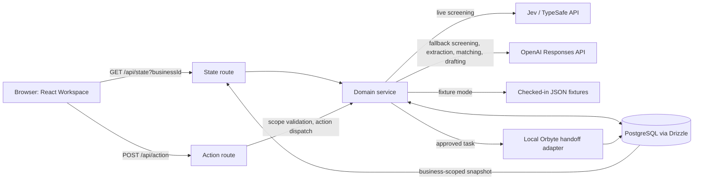
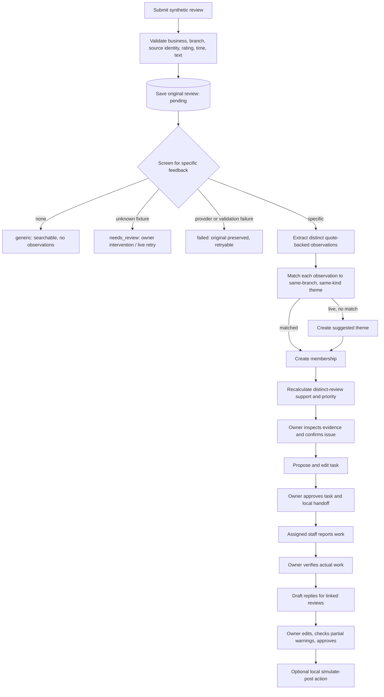
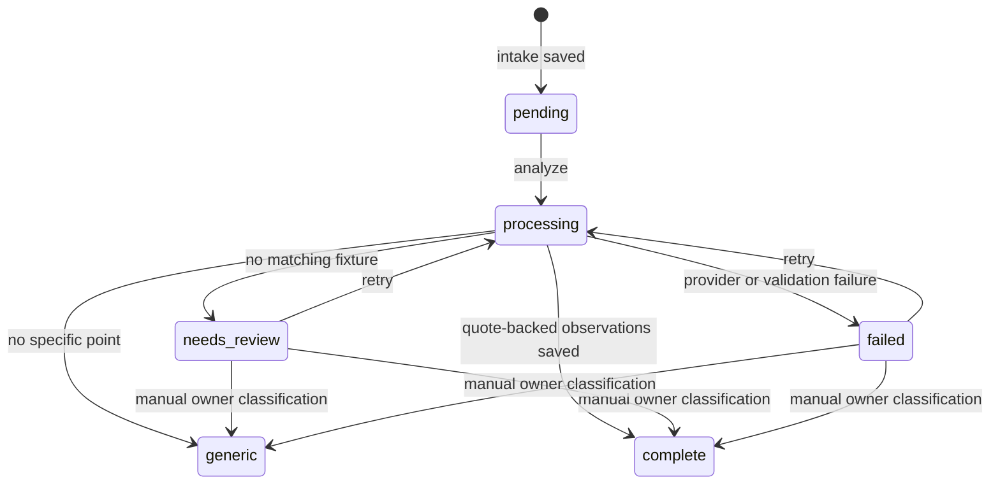
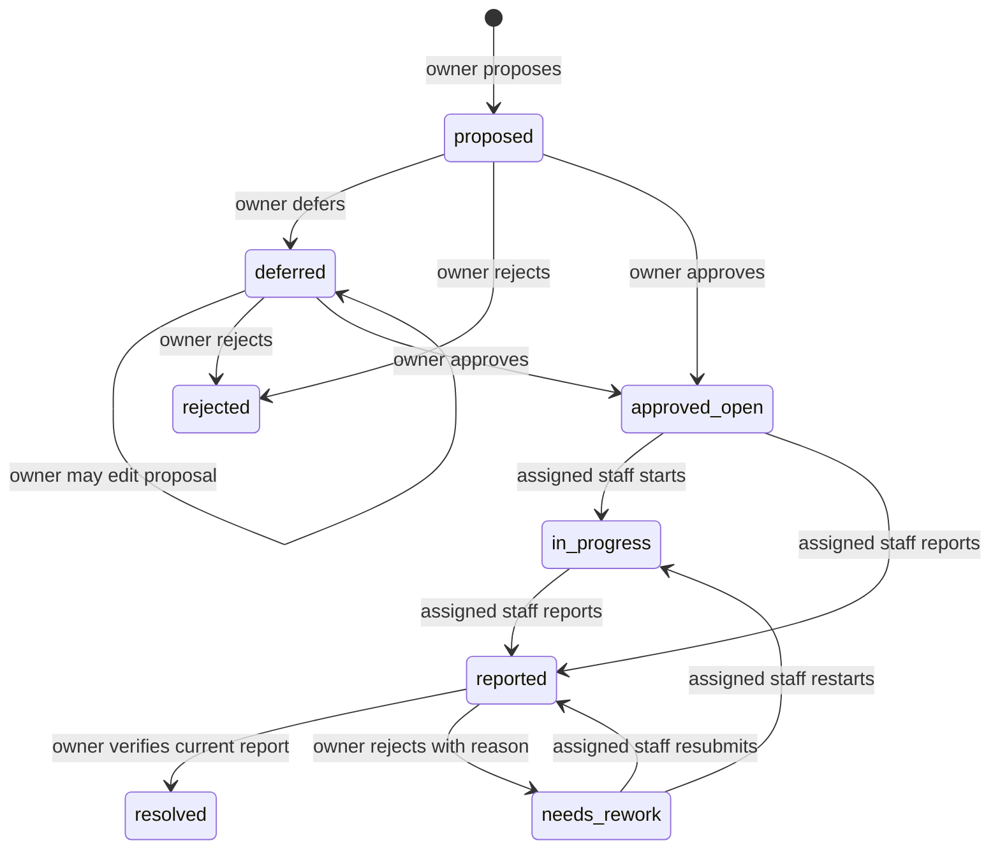
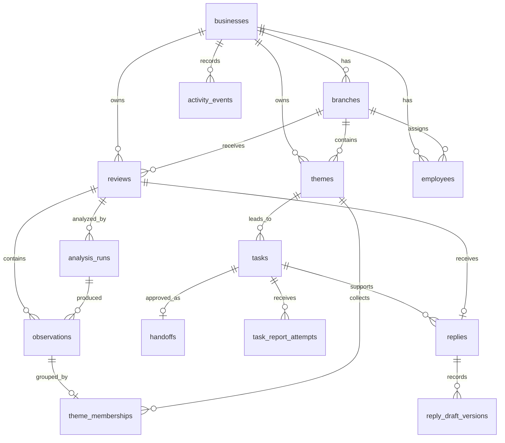

# Clarity: technical pipeline and teammate guide

This document describes the **implemented application** on the `ledger-redesign` branch. It follows a review from entry to analysis, evidence, operational work, and a public reply. It also explains the UI, database, provider integrations, fixture mode, failure paths, and the boundaries of this demo. Read [README.md](../README.md) for setup and the judge walkthrough; read [DESIGN.md](../DESIGN.md) for the visual system.

> **Vocabulary:** A _business_ is one workspace (hotel, restaurant, or salon). A _branch_ is a property or location within it. A _review_ is immutable source evidence. An _observation_ is one extracted point with an exact quote. A _theme_ is a grouped issue, suggestion, or positive pattern. A _membership_ connects one observation to one theme. A _task_ records work on an operational issue. A _reply_ is one draft/publication record per source review.

## 1. System at a glance



The browser never calls an AI provider or PostgreSQL directly. Next.js App Router route handlers run in the Node.js runtime. `src/domain/service.ts` orchestrates business rules and persistence; the provider adapters live under `src/integrations/`. `src/components/Workspace.tsx` holds the current client-side navigation and selection state. The main app is one route (`/`) with seven in-page tabs, not seven URL routes. `/launch` is a separate presentation page. `GET /api/prepared-reviews` currently returns `[]`; it does not load a real feed.

### Repository map

| Concern           | Main files                                                                   | Responsibility                                                                    |
| ----------------- | ---------------------------------------------------------------------------- | --------------------------------------------------------------------------------- |
| Main route and UI | `src/app/page.tsx`, `src/components/Workspace.tsx`, `src/components/design/` | Render workspace; fetch state; dispatch actions; filter, sort, and select records |
| Visual system     | `src/styles/`, `src/app/globals.css`, `DESIGN.md`                            | Ledger tokens, layout, responsive behavior, motion                                |
| HTTP boundary     | `src/app/api/state/route.ts`, `src/app/api/action/route.ts`                  | Read selected business and dispatch mutation types                                |
| Domain rules      | `src/domain/`                                                                | Validation, analysis, matching, priority, tasks, replies, errors                  |
| AI adapters       | `src/integrations/jev/`, `src/integrations/openai/`                          | Provider requests and structured results                                          |
| Workflow adapter  | `src/integrations/orbyte/handoff.ts`                                         | Local simulated handoff; no external API call                                     |
| Persistence       | `src/data/db.ts`, `src/data/schema.ts`, `migrations/`                        | Pool, Drizzle tables, constraints and additive SQL migrations                     |
| Fixture data      | `src/data/fixtures.ts`, `data/fixtures/visit2value/`                         | Deterministic synthetic reviews and labelled analysis                             |
| Maintenance       | `scripts/`                                                                   | Start, migrate, seed, validate/import, generate fixtures, reset                   |
| Verification      | `tests/`, `vitest.config.ts`                                                 | Domain, provider fallback, fixture and optional route tests                       |

## 2. The full journey



The steps are deliberately separate. Intake is a durable write before analysis. Analysis can fail without deleting the review. A positive observation is retained but does not become an operational repair task. A review can contain multiple observations and contribute to multiple themes. A theme can have many distinct source reviews. One review can have only one reply row.

### Sequence of a normal UI submission

```mermaid
sequenceDiagram
    actor Guest as Demo user
    participant UI as Workspace.tsx
    participant API as /api/action
    participant Service as service.ts
    participant DB as PostgreSQL
    participant AI as Fixture or live providers
    Guest->>UI: Enter review and choose property/rating
    UI->>API: POST type=intake, role, businessId, data
    API->>Service: assertActionScope then intake(data)
    Service->>DB: INSERT original review (pending) + event
    API-->>UI: reviewId
    UI->>UI: Open Reviews; start state polling
    UI->>API: POST type=analyze, reviewId
    API->>Service: analyzeReview(reviewId)
    Service->>DB: processing, stage=screening
    Service->>AI: screen; if useful, extract and match
    Service->>DB: transaction: run, observations, themes/memberships, final status
    Service->>DB: recalculate priority and append events
    API-->>UI: final analysis status
    UI->>API: GET /api/state?businessId=...
    API-->>UI: current business snapshot
    UI-->>Guest: Review, findings, issue links and feedback
```

The UI starts the second request after intake returns, and polls state once per second while analysis runs. The `analyze` request itself performs the processing; this is not a background job queue. A browser interruption after intake can leave a `pending` review, which can be analyzed later. The API also exposes `analyze_batch` for up to five pending reviews per call.

## 3. Runtime configuration and startup

The app uses Next.js 16, React 19, TypeScript, Drizzle ORM, PostgreSQL, Zod, and Vitest. Node 22.12+ or 24+ and PostgreSQL 16+ are expected. `scripts/server.mjs` starts Next with optional `HOST`/`PORT`; by default it binds `0.0.0.0:3000`.

```sh
npm ci
cp .env.example .env.local
# Set a local DATABASE_URL in .env.local; do not commit credentials.
npm run db:migrate
npm run db:seed
# Optional: populate historical synthetic reviews in a fresh database.
SEED_LEGACY_REVIEWS=yes npm run db:seed
npm run dev
```

| Variable              | Implemented meaning                                                                  |
| --------------------- | ------------------------------------------------------------------------------------ |
| `DATABASE_URL`        | PostgreSQL connection. Required for API state and actions.                           |
| `AI_MODE`             | Must explicitly be `fixture` or `live`. `.env.example` uses `fixture`.               |
| `TYPESAFE_API_KEY`    | Server-only Jev screening credential in live mode.                                   |
| `OPENAI_API_KEY`      | Server-only OpenAI credential for live fallback, extraction, matching, and drafting. |
| `OPENAI_MODEL`        | OpenAI model override; code defaults to `gpt-5-mini`.                                |
| `HOST`, `PORT`        | Bind address and port for `dev`/`start`.                                             |
| `SEED_LEGACY_REVIEWS` | `yes` adds checked-in historical review/analysis fixtures during seed.               |
| `CONFIRM_DEMO_RESET`  | Must be `yes` for destructive `npm run db:reset`.                                    |

`db:migrate` runs SQL files `0001` through `0004` in order. The scripts use repeatable `IF NOT EXISTS`/`ADD COLUMN IF NOT EXISTS` patterns. `db:seed` uses `onConflictDoNothing` for core records; historical review runs are skipped if already present, so a seed does not overwrite owner corrections. Generated fixture JSON is checked in; Python is only needed if intentionally regenerating it. The local `DB` is not part of Git.

**Fixture mode:** labelled reviews produce deterministic screening and observations without external keys. The lookup first finds a source fixture with the same business and exact text. There is also a narrow fallback for text that contains a checked-in fixture's full wording and its matching evidence quotes. Unknown wording becomes `needs_review`; it is still saved and searchable. The prepared-review endpoint is currently empty, so the sample picker in the UI may show no samples. Fixture output must not be reported as AI model performance.

**Live mode:** Jev screens first; OpenAI screens if Jev errors or returns an uncertain probability. OpenAI then extracts and matches specific observations. OpenAI drafts replies after verified work. External calls need valid keys and network access; this guide does not assert live provider availability.

## 4. HTTP contract and browser state

### Read state

`GET /api/state?businessId=harbour-house` returns a JSON snapshot. If `businessId` is omitted, the service defaults to Harbour House. An unknown business or unavailable database gives HTTP 500 with a public error message. The response contains `mode`, `synthetic`, all selectable business names, `selectedBusinessId`, and business-scoped arrays: `branches`, `employees`, `reviews`, `runs`, `observations`, `themes`, `memberships`, `tasks`, `handoffs`, `replies`, `events`, plus `themeSupport`.

`getState` queries business IDs first, then fetches related rows (several queries in `Promise.all`). `themeSupport[themeId]` counts unique `reviewId` values among a theme's member observations. Multiple mentions in one review count once. The API sends the complete selected-business snapshot; review filtering and paging are currently performed in the browser. As data grows, this may need server pagination.

### Mutate state

`POST /api/action` accepts JSON with `type`, `businessId`, a demo `role`, and fields for that action. The route calls `assertActionScope` **before** dispatching: it checks the selected business and any supplied review, observation, theme, task, reply, or reply IDs against that business. Intake also checks that `data.businessId` matches the selected workspace. Successful responses are `{ "ok": true, "result": ... }`; errors return HTTP 400 with `{ "ok": false, "error": "..." }` and workflow errors also include `code: "INVALID_WORKFLOW_STATE"`. Analysis provider failure is special: it can return HTTP 200 with `result.status = "failed"`, because the failure was recorded on the saved review.

Example (synthetic, fixture-compatible wording):

```json
{
  "type": "intake",
  "businessId": "harbour-house",
  "role": "staff",
  "data": {
    "businessId": "harbour-house",
    "branchId": "hotel-central",
    "source": "Guest review form",
    "sourceReviewId": "guest-unique-source-id",
    "rating": 2,
    "reviewedAt": "2026-10-30T10:00:00+08:00",
    "text": "The AC in room 226 blew warm air all night. We also saw a small insect near the bathroom sink. The front desk was patient and helpful.",
    "isSynthetic": true
  }
}
```

The returned `reviewId` is the database UUID, distinct from `sourceReviewId`. A follow-up `POST` with `type: "analyze"` and that `reviewId` processes it. The form creates a new synthetic source identity on submission; feed consumers should supply stable identities for idempotency.

### Implemented action types

| Type                           | Key inputs                                             | Service operation and rule                                                                                                                           |
| ------------------------------ | ------------------------------------------------------ | ---------------------------------------------------------------------------------------------------------------------------------------------------- |
| `intake`                       | `data`                                                 | Validate and persist original review.                                                                                                                |
| `analyze`                      | `reviewId`                                             | Run screening/extraction/matching or return already processed result.                                                                                |
| `analyze_batch`                | `limit`                                                | Sequentially analyze up to 5 pending reviews in selected business.                                                                                   |
| `manual_classify`              | `reviewId`, `data.useful`, optional `data.observation` | Owner classifies a pending/failed/needs-review review; optional observation must quote exact text. API exists but is not surfaced as a full UI form. |
| `membership`                   | `observationId`, nullable `themeId`                    | Owner removes or reassigns evidence to a compatible theme.                                                                                           |
| `theme_status`                 | `themeId`, `status`                                    | Owner confirms, dismisses, or reopens a suggested theme.                                                                                             |
| `severity`                     | `themeId`, `severity` 1–3                              | Owner changes triage severity and recalculates priority.                                                                                             |
| `propose_task`                 | `themeId`                                              | Owner proposes or reuses a task for active operational issue.                                                                                        |
| `edit_task`                    | `taskId`, `data`                                       | Owner edits proposed/deferred task, employee and due date.                                                                                           |
| `decide_task`                  | `taskId`, `decision`                                   | Owner approves, rejects or defers; approval saves a handoff snapshot.                                                                                |
| `start_task`                   | `taskId`, `employeeId`                                 | Assigned staff or owner moves approved work to in progress. API supported; main UI primarily uses report flow.                                       |
| `report_task`                  | `taskId`, `employeeId`, `note`                         | Assigned staff or owner submits work report (at least 10 characters).                                                                                |
| `verify_task` / `resolve_task` | `taskId`, `reportVersion`, optional `note`             | Owner verifies reported work; `resolve_task` delegates to the same verification.                                                                     |
| `draft_reply`                  | `reviewId`, `taskId`                                   | Owner drafts one reply for a review linked to resolved task.                                                                                         |
| `prepare_replies`              | `taskId`                                               | Owner drafts replies for all distinct reviews linked to the resolved theme, six concurrent drafts per batch.                                         |
| `edit_reply`                   | `replyId`, `text`, `draftVersion`                      | Owner edits draft/approved-ready reply; approval resets to draft.                                                                                    |
| `approve_reply`                | `replyId`, `draftVersion`, `partialApproved`           | Owner approves one draft, explicitly acknowledging unresolved complaints if necessary.                                                               |
| `approve_reply_batch`          | `replyIds` (1–300)                                     | Owner approves lower-severity, warning-free drafts.                                                                                                  |
| `simulate_publish`             | `replyId`                                              | Owner marks approved reply as posted locally.                                                                                                        |

Rejection actions are `reject_task_report` (`taskId`, `reportVersion`, `reason`) and `reject_reply` (`replyId`, `draftVersion`, `reason`). Both require the owner demo role, a current pending decision, and a meaningful reason. Their state change and activity event commit together.

The browser's `act()` helper posts an action, refreshes the state snapshot, and displays a status/error notice. A busy fieldset disables form controls during the action; the header's business/role selectors are also disabled. Switching businesses clears the old snapshot and selections, then loads the new one. A reference guards against a slower previous fetch overwriting the newly selected business. Tabs, filters, selections, and pagination are client state, so they reset on reload.

### What each UI tab consumes

| Tab        | Main purpose and data                                                                                                                                                                                                                                                          |
| ---------- | ------------------------------------------------------------------------------------------------------------------------------------------------------------------------------------------------------------------------------------------------------------------------------ |
| Dashboard  | Live counts from reviews/themes/tasks/replies; priority issues, recent activity, and work focus. Metric buttons open relevant tabs/filters.                                                                                                                                    |
| Reviews    | Source review register and full text, analysis runs, all observation kinds, linked issues/replies; client-side search, sort, filter and 8-per-page pagination.                                                                                                                 |
| Issues     | Operational issues or suggestions, priority and support, grouped exact quotes and source reviews; owner confirmation, dismissal, severity, evidence correction, task proposal. Positive patterns remain visible in review findings but are not in this operational issue list. |
| New review | Synthetic intake form, then analysis. It does not connect to a platform feed.                                                                                                                                                                                                  |
| Tasks      | Propose/edit/assign, staff report, owner verification, prepare linked replies; historical resolved tasks remain visible.                                                                                                                                                       |
| Replies    | One review beside each draft, partial warning, editing, individual or safe batch approval, simulated posting.                                                                                                                                                                  |
| Activity   | Business-scoped event history with UI filtering. Events are append-only records of consequential actions.                                                                                                                                                                      |

## 5. Intake and source-evidence invariants

`intakeSchema` (`src/domain/analysis.ts`) requires business/branch, source and source ID (3–100 characters), integer rating 1–5, ISO date-time with offset, 5–3000 characters of text, and `isSynthetic: true`. `intake` verifies that the branch belongs to the selected business. The review's `originalText` is stored exactly as received. A lightweight display language guess (`en`, `ms`, `mixed`, `unknown`) never decides whether to analyze the review.

The database unique index is `(business_id, source, source_review_id)`. If the same identity arrives again with the same text, branch, rating, and timestamp, intake returns the existing ID with `duplicate: true`. Changed evidence under the same identity yields a conflict; the existing row is not overwritten. An `onConflictDoNothing` path handles a concurrent duplicate insert and repeats the comparison. This protects source provenance while allowing safe feed replay. The original review can be found from every observation and from the issue evidence UI.

## 6. Screening, extraction, matching, and priority

### Screening decisions

`analyzeReview` accepts review states `pending`, `failed`, and `needs_review`. `complete` and `generic` are returned as already processed. It sets `processingStatus = processing`, records a `processingStage`, and appends an `analysis_started` event.



“Specific” includes concrete complaints, praise, suggestions, or other feedback about the business. Vague sentiment alone becomes `generic`. In live mode Jev's `specific_feedback.noul` result must be at most 0.4 or at least 0.6; a value between them is treated as uncertain and triggers OpenAI fallback. The Jev adapter makes at most two attempts with an eight-second timeout each. If both screening providers fail, the review becomes `failed`. OpenAI uses structured Responses API output validated by Zod, with a 60-second client timeout and one SDK retry. Server logs contain operation, safe error kind and HTTP status, not the API key.

### Exact-quote observations

For live extraction, `Intl.Segmenter` breaks the original review into sentence spans `s1`, `s2`, and so on. OpenAI selects a supplied span ID for each **distinct** observation and returns category, aspect, kind, sentiment, summary and normalized English description. The adapter maps the span ID back to the actual source sentence. `verifyEvidence` then confirms each quote is a substring of the original review, allowing only straight/curly quotation-mark equivalence. The persisted quote is taken from the original source string; it is not a model paraphrase. If screening says specific but extraction returns no observations, analysis fails visibly.

Observation kinds map to theme types:

| Observation kind          | Theme type          | Operational task?                      |
| ------------------------- | ------------------- | -------------------------------------- |
| `operational_complaint`   | `operational_issue` | Yes, with owner action and evidence    |
| `suggestion`              | `suggestion`        | No repair-task path in current service |
| `specific_praise`         | `positive_pattern`  | No                                     |
| `other_specific_feedback` | `positive_pattern`  | No                                     |

### Theme matching

Each observation is considered separately. The service loads themes for the review's **business and branch** once, then filters to the corresponding type. `candidateThemes` ranks candidates by overlapping title words and sends up to 100 to OpenAI. An exact normalized aspect/title match or an empty candidate list skips the provider. Other independent matches run in groups of three, and returned IDs must be among their candidates. In live mode, no match creates a new `suggested` theme with the observation's aspect as title; its membership is an `ai_suggestion`. In fixture mode, the labelled `expectedThemeId` is used when present; otherwise the observation can remain ungrouped. Before writing a membership, the service checks the theme's business, branch and type again. A database uniqueness rule allows only one theme membership per observation; an owner can move or remove it.

The run, observations, new themes, memberships and final review status are written in one transaction. `analysis_runs` stores screening/extraction/matching provider names, models, mode, prompt version, decision, and a safe error field. If analysis fails, a separate failed run and status are saved; the original review remains intact. Priority updates and activity events occur after the main transaction.

### Support and triage

Support is `COUNT(DISTINCT observations.review_id)` across a theme's memberships. Recent support counts reviews with `reviewed_at` within 180 days. Severity is owner-editable from 1 to 3. `priorityFor` yields:

| Condition for an operational issue                                                                          | Suggested priority |
| ----------------------------------------------------------------------------------------------------------- | ------------------ |
| Severity 3                                                                                                  | Urgent             |
| Possible recurrence, or severity ≥2 with ≥5 distinct reviews and recent support, or ≥10 with recent support | High               |
| ≥2 distinct reviews or severity ≥2                                                                          | Medium             |
| Otherwise                                                                                                   | Low                |

Non-operational themes are labelled `insight`. The stored `priorityReason` includes count, recent count, severity and recurrence; it is a triage suggestion, not proof of root cause. The UI groups evidence quotes for reading, while the support number remains based on distinct review IDs, not the number of rendered rows.

### Owner corrections and recurrence

`manual_classify` can resolve an unprocessed/failed review. It writes a manual run and, when supplied, one exact-quote observation. It does **not** automatically group that observation into a theme. `membership` lets an owner remove or assign an observation to a compatible same-branch/same-kind theme, then recalculates old and new priorities. Theme status transitions allow `suggested → owner_confirmed` or `suggested → dismissed`; dismissal can return to `suggested`. Severity changes also recalculate priority.

After a resolved task, new related evidence may set the theme to `recurrence` and permit a fresh task linked by `recurrenceOfTaskId`. The code compares the new review row's **created-at** time to the prior task's resolved-at time, not the guest's stated review date. Removing or moving evidence can refresh recurrence status. Old task and reply records are preserved.

## 7. Operational task and simulated handoff

Only an active `operational_issue` with at least one supporting source review can have a repair task. `proposeTask` takes an advisory transaction lock for that theme to avoid duplicate active proposals. It reuses an existing nonterminal task; after a resolved task, a new proposal requires `recurrence`. A proposed task starts with a suggested title/description, which the owner can edit. Assignment must use an employee at the same branch. Approval additionally requires an assignee and due date.



Approval gathers linked `{reviewId, quote}` evidence and creates a payload with business, branch, approved task text, assignee, due date, approver and approval time. `localHandoff.simulate()` returns `simulated_queued` and the payload. A database transaction stores the task's `approvalSnapshot`, an associated `handoffs` row, and approval/handoff events. **No Orbyte endpoint is called.** Clarity's task row remains the source of truth.

The assigned staff demo role may start or report on its own task; an owner may do so for a very small business. A report needs at least ten characters. Each submission increments `report_version` and adds a `task_report_attempts` row. Only the owner role can decide a `reported` task, and its request must name the current report version. Verification uses an optional meaningful verification note or the employee report as the recorded `resolutionNote`; it sets `resolvedAt`, `verifiedAt`, `verifiedBy`, and appends an event. Rejection requires a 10–500 character reason, records the actor/time and decision on that attempt, changes status to `needs_rework`, and appends an event in the same transaction. The employee can read the feedback, restart or submit a corrected report; previous reports and decisions remain stored. Concurrent decisions on the same report are rejected by conditional updates. Reply drafting requires `resolved`, so a rejected or unverified task cannot be used to generate a dependent reply. The role switcher and employee selector are **demo controls**, not identity proof. A real deployment must add authentication, server-derived actor identity, and authorization.

## 8. Reply controls and publication boundary

`createReply` requires a `resolved` task with a nonblank verified resolution note and a review whose observation is a member of that task's theme. The database enforces one reply per review even if the review supports several themes. Existing replies are returned unchanged. `prepareReplies` finds distinct linked reviews and calls drafting in groups of six.

Before drafting, the service reads **other operational complaints in the same review**. A complaint is still unresolved if it has no membership or its theme has no resolved task. The full original review, verified note, business name, and unresolved summaries are supplied to OpenAI in live mode. If live drafting fails, a clearly labelled `template_fallback` draft is saved. Fixture mode uses a deterministic template. Draft source, mode and model are stored on each reply.

```mermaid
stateDiagram-v2
    [*] --> draft: verified work + linked evidence
    draft --> approved_ready: owner approves current version
    draft --> needs_revision: owner rejects with reason
    needs_revision --> draft: owner submits revised draft
    approved_ready --> draft: owner edits; approval revoked
    approved_ready --> simulated_published: owner simulates posting
    simulated_published --> [*]
```



If another complaint remains unresolved, `partialWarning` explains it. Individual approval then requires `partialApproved: true` and rejects broad claims that all concerns were resolved. This rule is a conservative text-pattern guard, not a full semantic fact checker; owners must read the original review. Every edit increments `draft_version`, stores a `reply_draft_versions` row and clears prior approval. Rejection of a pending draft requires a 10–500 character reason, records actor/time and an event, and moves it to `needs_revision`. Editing that draft resubmits it for approval. Approval must name the current version and stores `approved_version`; publishing requires `approved_ready` and the exact version match. Conditional updates prevent stale and duplicate decisions; denied publishing attempts are recorded separately. Published demo replies cannot be edited. Batch approval accepts 1–300 IDs but only drafts with no warning and theme severity below 3. `approved_ready` still means **nothing was published**. `simulate_publish` records `simulated_published` and a local timestamp/event; there is no review-platform API call.

## 9. Persistence and relationships



| Table                                 | Important stored facts                                                                                          |
| ------------------------------------- | --------------------------------------------------------------------------------------------------------------- |
| `businesses`, `branches`, `employees` | Workspace, property, and fictional assignee identity.                                                           |
| `reviews`                             | Source identity, original wording, rating/date, synthetic/historical flags, language, processing status/stage.  |
| `analysis_runs`                       | Each attempt's decision, mode, provider/model provenance, prompt version, safe failure.                         |
| `observations`                        | One point, kind/sentiment/category, normalized meaning, exact quote and offsets, provider provenance.           |
| `themes`                              | Branch-specific grouped topic, type, status, severity, calculated priority/reason.                              |
| `theme_memberships`                   | Observation-to-theme association, suggested/owner-confirmed provenance; observation ID is unique.               |
| `tasks`                               | Work proposal, assignee, due date, status, report, approval snapshot, verification/resolution, recurrence link. |
| `task_report_attempts`                | Immutable report submissions with version, note, submitter and subsequent decision/reason.                      |
| `handoffs`                            | One local simulated handoff payload/status per approved task.                                                   |
| `replies`                             | One reply per review, verified task link, draft/source, warning, approval, simulated publication.               |
| `reply_draft_versions`                | Text and source for each submitted draft version.                                                               |
| `activity_events`                     | Append-only business-scoped descriptions and metadata for consequential actions.                                |

`0001_initial.sql` creates the original schema. `0002_hotel_workflow.sql` adds employees, task report/verification/recurrence fields, reply warning/publication fields, and business scope on events. `0003_historical_imports.sql` marks known fixture reviews as historical so “New today” does not count them. `0004_rejection_workflow.sql` adds report and draft version tracking, rejection fields, and attempt history; it backfills existing reports and drafts. The SQL schema is the database authority; `src/data/schema.ts` is its Drizzle mapping. Most relations use foreign keys, but some cross-business and cross-branch consistency rules are enforced in the service rather than by composite database constraints.

## 10. Error handling, audit trail, and practical limits

- **Intake validation:** Zod errors become short field-specific public messages. Duplicate source identity with changed evidence is rejected and preserved. Database connection errors become “workspace unavailable.”
- **Provider failures:** Jev has OpenAI screening fallback. Failed extraction, matching, or invalid quotes leave the review in `failed`, with a failed run and safe message. A stored review can be retried. A reply-draft provider failure produces a template fallback for owner review.
- **Activity:** Intake, analysis start/result/failure, membership correction, theme decisions, task transitions, handoff, reply transitions, and recurrence append events. Dashboard previews suppress duplicate descriptions and handoff noise; the Activity tab shows individual decision, denial, and handoff records. Events are descriptive audit history within a demo, not tamper-proof compliance logs.
- **Scope:** State and actions check business IDs. However, the role and employee IDs are client-supplied demo values; there is no login, session, or real tenant authorization. Do not treat this as a secure multi-tenant production service.
- **External systems:** Review sources, people, and results are synthetic. No source scraping, real Orbyte delivery, or real posting occurs. The incoming JSON script is a local validation/import utility, not a continuously connected feed.
- **Scale/concurrency:** State returns all records for a business, with UI-side filtering. Analysis is request-driven, not queued. The task proposal uses a lock and approval uses a conditional status update, but analysis does not implement a distributed worker lock; concurrent requests for the same pending review require care in a production implementation. Batch reply approval validates first, then approves sequentially; it is not one all-or-nothing transaction.
- **Deployment:** Replit can run the same scripts with a provisioned PostgreSQL database and server-side secrets. The repository alone does not prove the external deployment's current state.

## 11. Debugging and verification playbook

```sh
npm run typecheck
npm run lint
npm test
npm run build
```

`npm test` runs the fast Vitest domain/fixture tests. Route integration tests in `tests/api.integration.test.ts` run only when `TEST_BASE_URL` is set; they write a synthetic review, so point them at a **disposable** running database:

```sh
TEST_BASE_URL=http://localhost:3000 npm test
```

To validate the checked-in incoming JSON without writing rows, run `npx tsx scripts/process-incoming-reviews.ts`. `--run` imports and analyzes those reviews with 12 concurrent workers and **requires `AI_MODE=live`**; use a controlled database and provider credentials. `npm run db:reset` drops the public schema and requires `CONFIRM_DEMO_RESET=yes`; do not use it on a teammate's working data.

When a review looks wrong, inspect in this order:

1. `reviews`: business/branch, source identity, original text, `processingStatus`, and `processingStage`.
2. `analysis_runs`: latest decision, mode, provider/model fields and `safeError`.
3. `observations`: exact quote and `reviewId`; verify it appears in `originalText`.
4. `theme_memberships` and `themes`: grouping compatibility, status, distinct support, severity and priority reason.
5. `tasks`, `handoffs`, `replies`, `activity_events`: work state, approved snapshot, verified note, partial warning and simulated publication.

For a UI issue, check the selected business, active tab, review filters and page before assuming data disappeared. Dashboard and Issues counts are derived from the same state snapshot; a newly ingested review is visible immediately, while its observations appear only after analysis finishes. Browser console errors, route responses and server logs help distinguish UI state from backend/provider failure. Never paste API keys or database URLs into bug reports.

### Ownership of common changes

- Add or modify a review field: update Zod intake, SQL migration, Drizzle schema, service write/read, UI type and relevant tests.
- Change AI extraction: edit the OpenAI adapter/prompt, Zod observation schema and evidence tests; preserve exact source quotes and provider provenance.
- Change grouping/priority: edit `themes.ts`, `priority.ts`, service matching/recalculation and domain tests; keep branch/kind boundaries.
- Add a workflow transition: edit service and shared workflow rules, activity event, UI state/feedback and transition tests.
- Add real identity or external integrations: replace demo role/adapter assumptions explicitly; retain evidence, approval and audit boundaries.

The shortest reliable mental model is: **a source review is preserved first; every AI result is recorded as a separate interpretation; an owner decides what work is warranted; verified work supports a reviewed reply; external delivery and posting remain simulated.**
